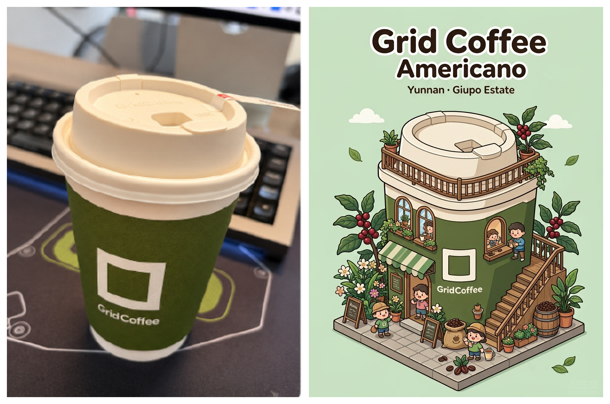
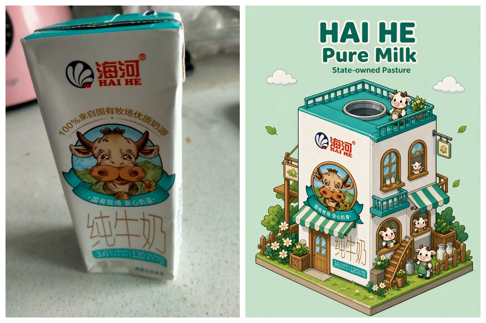
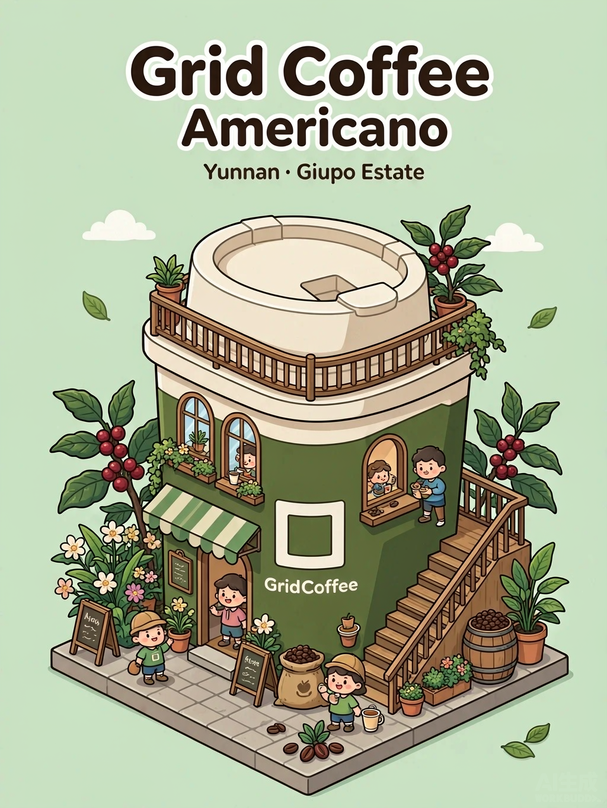
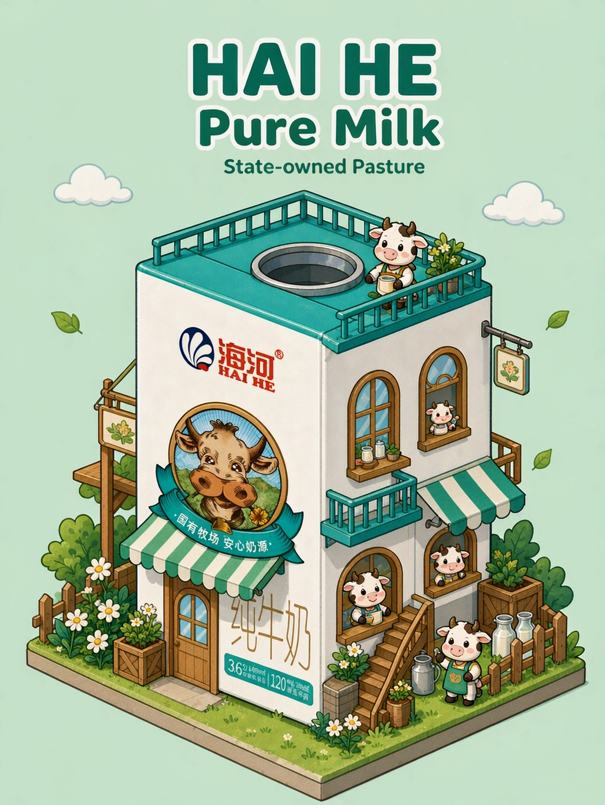

# 一杯饮料，一座小店 · WorkBuddy 技能

上传一张咖啡 / 奶茶 / 牛奶照片，自动生成一张**由包装组成的 2D 等轴测微缩门店插画**，并附一张「真实原图 + 插画」高清对比图。

粗黑描边、纯色平涂、45° 等轴测视角、品牌标题、楼梯遮阳棚与吉祥物——像 Adobe Illustrator 做的商业 IP 插画海报，而不是 3D 渲染。

---

## DEMO

### 01 · Grid Coffee 美式咖啡



> 深绿杯身变成两层店铺，米白杯盖变成屋顶露台，白色空心方框 logo 原样留在墙上；云南庄园化作 A 字牌、咖啡果枝和几只店员小人。

### 02 · 海河纯牛奶（盒装包装同样适用）



> 白色砖形纸盒变成牧场小楼，青绿盒顶封边变成带天窗的屋顶露台，中央奶牛圆徽章升级成正面圆形招牌，包装上原有的中文与营养标签也被完整保留。

<details>
<summary>展开查看两张独立插画（无拼接版）</summary>





</details>

---

## 安装（30 秒）

把 **`cup-shop-illustration/` 整个文件夹**复制到 WorkBuddy 的用户级技能目录：

| 系统 | 目标路径 |
|---|---|
| Windows | `C:\Users\<你的用户名>\.workbuddy\skills\` |
| macOS / Linux | `~/.workbuddy/skills/` |

Git Bash / 终端一键安装（在本目录执行）：

```bash
mkdir -p "$HOME/.workbuddy/skills"
cp -r cup-shop-illustration "$HOME/.workbuddy/skills/"
```

然后**新开一轮对话**即可触发。也可在 GitHub 点 `Code → Download ZIP`，解压后同样复制这个子目录。

### 依赖

| 依赖 | 说明 |
|---|---|
| WorkBuddy 内置 `ImageGen` | 负责图生图，每张约 5–10 积分，出图前助手会先告知 |
| Python 3 + Pillow | 图片预处理与拼接；托管环境一般已自带，缺了就 `pip install Pillow` |
| 网络 / API Key | **不需要**。`scripts/imgtool.py` 纯本地运行，不联网、不上传文件 |

---

## 使用

把照片拖进对话，说一句：

> 用「杯子门店插画」技能，把这张照片变成等轴测微缩门店插画

「把这张咖啡照片变成由杯子组成的小店」「奶茶杯子做成等轴测插画」也会触发。

**选填信息**（不填就从照片自动识别，识别不出不会瞎编）：品牌名称、饮品名称、联名信息、其他特色（咖啡豆产地、庄园、特殊配料等）。技能会一次跑完，不逐步找你确认。

---

## 你会拿到

| 文件 | 内容 |
|---|---|
| `<原名>_illustration.png` | 一张**独立完整**的等轴测门店插画（不是从对比图裁出来的） |
| `<原名>_compare.png` | 真实原图 + 插画的无裁切拼接图（竖版左右拼 / 横版上下拼） |

---

## 常见问题

| 问题 | 处理 |
|---|---|
| 生成的像 3D 渲染 / 写实照片 | 风格锚点前置并追加负面词，最多重出一次 |
| 杯型或品牌色被换掉 | 把 `input_fidelity` 调高，并在识别段写死主色与 logo 位置 |
| 右下角有「AI生成 WORKBUDDY」水印 | 平台强制叠加，用 `cleanwm`（默认 `selective`）无痕清除，别裁地台 |
| HEIC / 特殊格式读不了 | 先转成 PNG/JPG 再跑，脚本会明确报错，不会静默失败 |
| 中文招牌乱码 | 照搬包装上已有的中文成功率高；凭空写新中文容易乱码，标题建议用英文 |
| 想省积分 | 一次只出一张；本地脚本不消耗积分 |

---

## 目录结构

```
cup-shop-illustration-分享包/
├── README.md                        ← 本文件（首页说明 + DEMO）
├── cup-shop-illustration/           ← 技能本体，整个复制到 skills 目录即可
│   ├── SKILL.md                     # 六步工作流、硬规则、可调项
│   ├── README.md                    # 技能自身的中文使用说明
│   ├── references/
│   │   ├── prompt-master.md         # 完整提示词模板、槽位、示例、实测记录
│   │   └── diagnose.md              # 识别卡、九条自检、失败修法表
│   └── scripts/
│       └── imgtool.py               # prepare / cleanwm / compose / trim / sheet
└── examples/                        ← 两组实测成品
    ├── 01-grid-coffee-compare.png
    ├── 01-grid-coffee-illustration.png
    ├── 02-haihe-milk-compare.png
    └── 02-haihe-milk-illustration.png
```

---

## 隐私与安全说明

- 本仓库 / 分享包**不含任何 API Key、访问令牌、Cookie 或账号密码**；技能脚本不读环境变量里的凭据。
- 图像生成走 WorkBuddy 内置工具，本地脚本只读写你指定的图片文件。
- ⚠️ `examples/` 里的**对比图左侧是真实原始照片**（含拍摄环境）。公开仓库或转发前请确认你不介意这部分被看到；若只想展示插画，改用 `*-illustration.png`。
